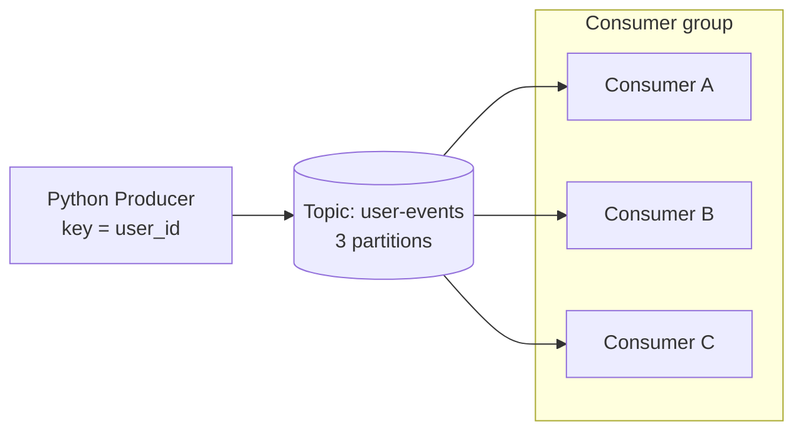

# Kafka Mini Project – User Activity Event Pipeline

> **Part of a progression:** this repo covers **Kafka fundamentals** in Python. The production-style follow-up, with idempotent processing, retries, and a dead-letter topic, is [`idempotent-kafka-pipeline`](https://github.com/surya532/idempotent-kafka-pipeline) (Java 17, Spring Boot).

## 📌 Overview

This project is a **minimal, hands-on Kafka pipeline** built to understand **how Kafka works internally**, not just how to use it.

It demonstrates:

* Kafka topics & partitions
* Producers with message keys
* Consumer groups & parallelism
* Offset management & replay
* Fault tolerance & rebalancing

The project runs **locally using Docker and Python**.

---

## 🧠 Architecture



---

## 🛠 Tech Stack

* **Apache Kafka** – distributed event streaming platform
* **Python** – producer & consumer implementation
* **Docker & Docker Compose** – local Kafka setup
* **kafka-python** – Kafka client library
* **GitHub Actions** – lint and compile checks on every push

---

## 📂 Project Structure

```
kafka-mini-project/
├── .github/workflows/ci.yml   # lint + compile checks
├── docs/LESSONS.md            # what I learned running the experiments
├── docker-compose.yml         # Kafka setup
├── producer.py                # Kafka producer
├── consumer.py                # Kafka consumer
├── requirements.txt
└── README.md
```

---

## 🚀 Getting Started

### Prerequisites

* Docker
* Python 3.9+
* pip

---

## 🐳 Start Kafka

```bash
docker compose up -d
```

Verify Kafka is running:

```bash
docker ps
```

---

## 🧵 Create Kafka Topic

```bash
docker exec -it kafka kafka-topics.sh \
  --create \
  --topic user-events \
  --bootstrap-server localhost:9092 \
  --partitions 3 \
  --replication-factor 1
```

Describe the topic:

```bash
docker exec -it kafka kafka-topics.sh \
  --describe \
  --topic user-events \
  --bootstrap-server localhost:9092
```

---

## 🐍 Install Python Dependencies

```bash
pip install -r requirements.txt
```

---

## ✉️ Run Producer

The producer sends simulated user activity events.

```bash
python producer.py
```

Example event:

```json
{
  "user_id": "u1",
  "event_type": "click",
  "page": "/home"
}
```

* Messages are keyed by `user_id`
* Same user → same partition
* Ordering is preserved per user

---

## 👥 Run Consumer

Start one consumer:

```bash
python consumer.py
```

Output example:

```
Partition=1 Offset=12 Value={'user_id': 'u1', 'event_type': 'click', 'page': '/home'}
```

---

## 🔀 Consumer Group Scaling

Open **multiple terminals** and run:

```bash
python consumer.py
```

What happens:

* Kafka distributes partitions across consumers
* Each partition is processed by **only one consumer per group**
* This demonstrates Kafka’s parallelism model

---

## 🔁 Offset Management & Replay

### Resume from last offset

* Stop and restart the consumer
* It resumes from the last committed offset

### Replay all events

Change `group_id` in `consumer.py`:

```python
group_id="new-consumer-group"
```

Run again to replay the entire topic from the beginning.

---

## 💥 Fault Tolerance Demo

1. Run two consumers
2. Kill one consumer
3. Kafka automatically reassigns partitions to the remaining consumer

This demonstrates **rebalancing and failure handling**.

---

## 🧠 Key Kafka Concepts Demonstrated

* Topics & partitions
* Message keys & ordering
* Consumer groups
* Offset commits
* Replay & backfill
* Fault tolerance
* Pull-based consumption

---

## ❓ Why Kafka (Not a Queue)?

Kafka is used because:

* Events are **stored durably**
* Multiple consumers can read the same data
* Consumers can **replay historical events**
* Producers and consumers are **decoupled**

This project intentionally focuses on **streaming semantics**, not task queues.

---

## 📝 Lessons Learned

See [docs/LESSONS.md](docs/LESSONS.md).

---

## ⚠️ Limitations

* Single broker with replication factor 1, so this is not a durability demo
* At-least-once semantics only; no deduplication (handled in the Java follow-up)
* No schema registry; events are plain JSON
* `kafka-python` client; no consumer lag dashboards

---

## 📈 Possible Extensions

* Add an S3 sink consumer
* Add OpenSearch indexing
* Compare Kafka vs AWS SQS
* Add schema validation (Avro/Protobuf)
* Deploy using AWS MSK
* Add monitoring (lag metrics)

> Idempotent processing, retries, a dead-letter topic, and Prometheus metrics are implemented in [`idempotent-kafka-pipeline`](https://github.com/surya532/idempotent-kafka-pipeline).
